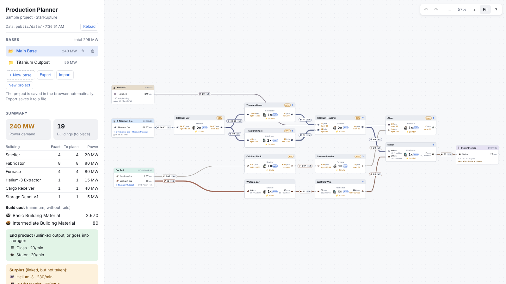

# StarRupture Production Planner

> **This is an AI-written project.** The code, the documentation and the game data files
> were written by an AI – **Anthropic Claude Opus 5.5 in Extra mode**, generated over many
> iterative cycles (requirement → implementation → automated verification → refinement).
> A human maintainer directed the work: set the requirements, supplied the game data and made
> the design decisions. Review it like any other code before you rely on it.

A browser-based production chain planner for the game **StarRupture**. You build your factory
on a canvas, split into bases: place factories, mines, cargo Dispatchers and Receivers,
storages and rail lines, link them, and the planner computes how much material moves over
every link, where something is missing or left over, the power demand, the minimum build
cost and the drone rails you need.



## Features

- **Node editor** – right-click to place, drag item rows to link, box select, copy / paste,
  undo / redo, automatic layout (ELK), light and dark theme.
- **Flow calculation** – one linear program over all bases: shortages at the bottleneck,
  surplus, effective output of a short factory (it cascades down the chain), even
  distribution between sources and consumers.
- **Machine counts** – automatic (sized from the material that reaches the factory, rounded
  up) or typed by hand; *Balance* computes exact counts from the consumer demand.
- **Build chain** – places the whole supply chain of a missing input down to the raw
  materials (recipe choice by fewest buildings or lowest power).
- **Logistics** – drone rail tiers per link (one rail per node pair, several items on it),
  manual mixed rail sets with congestion, rail lines (collectors), cargo Dispatcher →
  Receiver pairs (with a virtual counterpart for unpaired nodes), inter-base rails, storages.
- **Summary** – power demand (a fractional machine counts as a whole one), buildings to place,
  minimum build cost, end products, per base and for the whole project.
- **Data-driven** – all game data lives in YAML files with a JSON schema for editor
  completion; a new item, recipe or building needs no code change. Live reload while you edit.

## Quick start

```bash
npm ci
npm run dev                    # http://localhost:5173
```

Node.js 22.12 or newer is required (Node 26 LTS recommended). Production build, web server
and Docker: [INSTALL.md](INSTALL.md).

**On GitHub Pages:** the workflow `.github/workflows/pages.yml` checks, builds and publishes the
planner on every push to `main` (one-time setting: Settings → Pages → Source: GitHub Actions);
the site is then at `https://<owner>.github.io/<repository>/`. Details:
[INSTALL.md › GitHub Pages](INSTALL.md#6-github-pages).

## Where the data comes from

The game data (`public/data/`) and the icons (`public/icons/`) come from:

- **MetaForge** – [metaforge.app/starrupture](https://metaforge.app/starrupture), October–November
  2026: the primary source for buildings, recipes, mines, build costs and icons.
- A few values from other places: the StarRupture wiki (mine purity multipliers), a Steam
  community guide (one building whose MetaForge page was unavailable) and measurements in the
  game by the maintainer.

The data is **real but incomplete**: it covers part of the game and grows over time. Values
that are not verified are marked in the YAML comments; recipes whose cycle time is unknown
compute with 0 and are flagged in the UI (you can enter the cycle time yourself). The full
list, the rules for adding data and the missing data: [docs/DATA-SOURCES.md](docs/DATA-SOURCES.md).

StarRupture, its item and building names and its icons belong to their respective owners.
This is an unofficial fan project, not affiliated with the game's developer or with MetaForge.

## Documentation – where to find what

| You want to… | Read |
|---|---|
| use the planner (canvas, numbers, game rules it follows) | [docs/USER-GUIDE.md](docs/USER-GUIDE.md) |
| install, build, deploy (web server, GitHub Pages, Docker) | [INSTALL.md](INSTALL.md) |
| edit the game data (YAML fields, values, icons, limits) | [docs/CONFIGURATION.md](docs/CONFIGURATION.md) |
| know where the data comes from, what is missing | [docs/DATA-SOURCES.md](docs/DATA-SOURCES.md) |
| understand the code: layers, state, business rules, conventions | [docs/ARCHITECTURE.md](docs/ARCHITECTURE.md) |
| understand the calculation: model, flow LP, balancing, drawing | [docs/GRAPH-ENGINE.md](docs/GRAPH-ENGINE.md) |
| open a pull request by hand | [CONTRIBUTING.md](CONTRIBUTING.md) |
| work with an AI agent (Claude Code, GitHub Copilot) | [AGENTS.md](AGENTS.md), [docs/AI-AGENTS.md](docs/AI-AGENTS.md) |

## Contributing

Pull requests written by hand are welcome. [CONTRIBUTING.md](CONTRIBUTING.md) has the setup,
the repository map, where to change what, the code conventions and the checklist to run before
you open a PR; GitHub Actions runs the same checks on every pull request. The same rules apply
to AI agents ([AGENTS.md](AGENTS.md)); the step-by-step
checklists in `.claude/skills/` (e.g. adding game data or a new building type) are useful for
humans too.

## Tech stack

| Area | Tool |
|---|---|
| UI | Vue 3.5 (TypeScript, one folder per component: template + logic + SCSS) |
| Language | TypeScript 6.0 (type checking with vue-tsc) |
| Build, dev server | Vite 8 |
| Styles | SCSS (Dart Sass), colour tokens as CSS custom properties |
| Calculation | yalps (linear programming), ELK.js (automatic layout) |
| Data | YAML (`yaml`), JSON Schema for editor completion |
| Code quality | ESLint 10 + typescript-eslint + eslint-plugin-vue, Prettier 3 |
| Engine smoke test | tsx (`npm run smoke`) |
| CI / hosting | GitHub Actions → GitHub Pages; Dependabot for action and npm updates |

There is no backend and no database: the project is stored in the browser (with JSON export /
import), the game data is static files. TypeScript 7 (the native compiler) is not used yet:
vue-tsc and typescript-eslint do not support it until its programmatic API ships (planned for
7.1).
